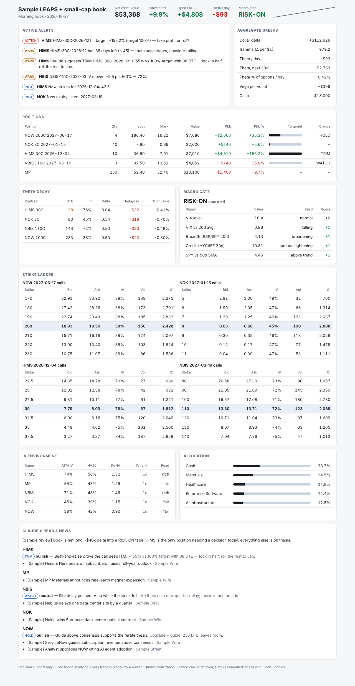

# Claude Trader — research prompts + daily options-book monitor

A clone of the "Claude as research analyst + portfolio manager" method: Claude designs the strategy and picks the trades in the web app (no API cost), then a small four-layer system watches the book every morning and flags what changed. **A human places every trade.**

> Not financial advice. No profits are implied or guaranteed. The sample book and headlines in `fixtures/` are fictional.



## The method

| Phase | Where | Mode | What happens |
|-------|-------|------|--------------|
| 1. Strategy | Claude web app | Non-deterministic (analyst) | [`prompts/01-strategy.md`](prompts/01-strategy.md): account size, risk tolerance and holding period in, monthly strategy out (LEAPS >45 DTE on liquid names, shares on small caps where options are illiquid or IV is rich) |
| 2. Screen | Claude web app | Non-deterministic | [`prompts/02-screen.md`](prompts/02-screen.md): oversold names with a dated catalyst plus momentum names, scored on catalyst timing, IV, liquidity and correlation, then combined across catalyst windows and sectors |
| 3. Contracts | Claude web app | Non-deterministic | [`prompts/03-contracts.md`](prompts/03-contracts.md): exact strike, expiry and size per name, output as `portfolio.json` |
| 4. Daily monitor | Your machine, once a day | Deterministic + one Claude call | `python -m trader.monitor`: values the book, checks the chain, reads the news, raises alerts and writes the dashboard |

The key point from the method is context. Give Claude your account size, risk limits and holding period, not "what should I buy?"

## The four layers

| Layer | File | Cost | Does |
|-------|------|------|------|
| 1. Data & valuation | `layer1_valuation.py` | free | Spot plus the full chain for every name, matches each held contract, re-solves IV from the mid, computes Greeks locally (Black-Scholes, `greeks.py`), P&L and progress to target/stop, saves a daily snapshot |
| 2. Portfolio analytics | `layer2_analytics.py` | free | NAV, allocation by name and sector, aggregate Greeks, theta bleed per day and over 30 days, IV environment (ATM IV vs 30-day realized vol; IV rank once 5+ snapshots exist) |
| 3. Context & news | `layer3_context.py` | about one Claude call/day | Deterministic macro gate (VIX level and trend, RSP/SPY breadth, HYG/IEF credit, SPY vs 50-day) and technicals (RSI, 20/50 SMA, % off high), plus **one** Claude call that reads the news and price action for every name and returns sentiment and hold/add/trim/exit/watch with a reason |
| 4. Alerts & dashboard | `layer4_alerts.py`, `dashboard.py` | free | Target/stop/near-target, DTE under 45, IV moves of 5+ pts, new strikes and expiries vs yesterday's snapshot, concentration, risk-off gate and Claude's calls → `out/dashboard.html`, `out/alerts.json`, optional Telegram push |

## Run it

```bash
# 1. Offline demo on the sample book (no network, no keys):
python -m trader.monitor --portfolio trader/portfolio.example.json --fixture trader/fixtures/day1.json --out /tmp/demo
python -m trader.monitor --portfolio trader/portfolio.example.json --fixture trader/fixtures/day2.json --out /tmp/demo
#    open /tmp/demo/dashboard.html  (day 2 shows target, DTE, IV-move, new-strike and new-expiry alerts)

# 2. Your real book:
pip install -r trader/requirements.txt
cp trader/portfolio.example.json trader/portfolio.json   # paste in the JSON from prompt 03, then use your actual fills
python -m trader.monitor --llm dry-run                   # check exactly what Claude would be sent; no API call
export ANTHROPIC_API_KEY=...                             # then run for real each morning
python -m trader.monitor
```

- `--llm auto|off|dry-run|live`. `auto` (the default) goes live only when `ANTHROPIC_API_KEY` is set. The model comes from `CLAUDE_MODEL_TRADER` (default `claude-sonnet-5-5`).
- `--push` sends ACTION/WARN alerts to Telegram (`TELEGRAM_BOT_TOKEN`, `TELEGRAM_CHAT_ID`).
- `trader/portfolio.json` and `trader/out/` are git-ignored, so your positions stay on your machine.
- Run it once a day, after the open or before it. Snapshots are keyed by date, so a re-run on the same day overwrites rather than duplicates.

**Schedule it.** On Mac or Linux, `crontab -e` → `45 9 * * 1-5 cd /path/to/repo && python -m trader.monitor --push`. On Windows, use Task Scheduler with the same command.

## portfolio.json

`cost_basis` is per share, so an option filled at $14.20 is `14.20`, not `1420`. `type` is `call`, `put` or `stock`. `target_pct` and `stop_pct` are P&L % on the position. The optional `underlying_target` alerts when the stock price reaches it. Add tickers to `watch` to track new strikes on names you don't hold yet.

## Data sources

Yahoo Finance via `yfinance` is free and fine for one daily run, but quotes can be delayed and its IVs are noisy. That's why IV is re-solved from the bid/ask mid. For better data, write a provider with the same five methods (`spot`, `history`, `expiries`, `chain`, `news`) in `providers.py` for Polygon or FMP.

## Tests

`pytest -q tests/test_trader.py` runs offline. It checks Black-Scholes against textbook values, the IV round trip, RSI, the two-day alert pipeline, idempotent re-runs, and the live Claude path against a local mock endpoint.
